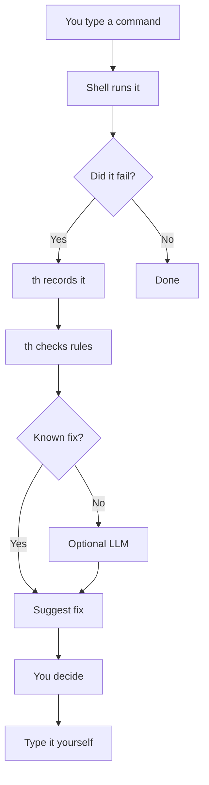
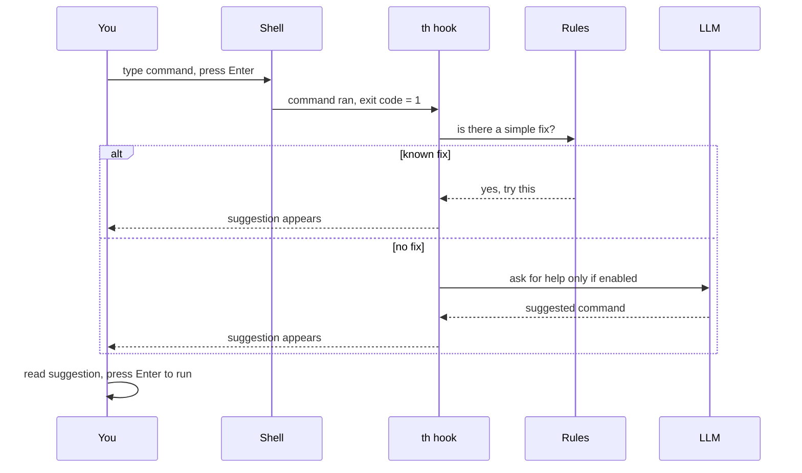
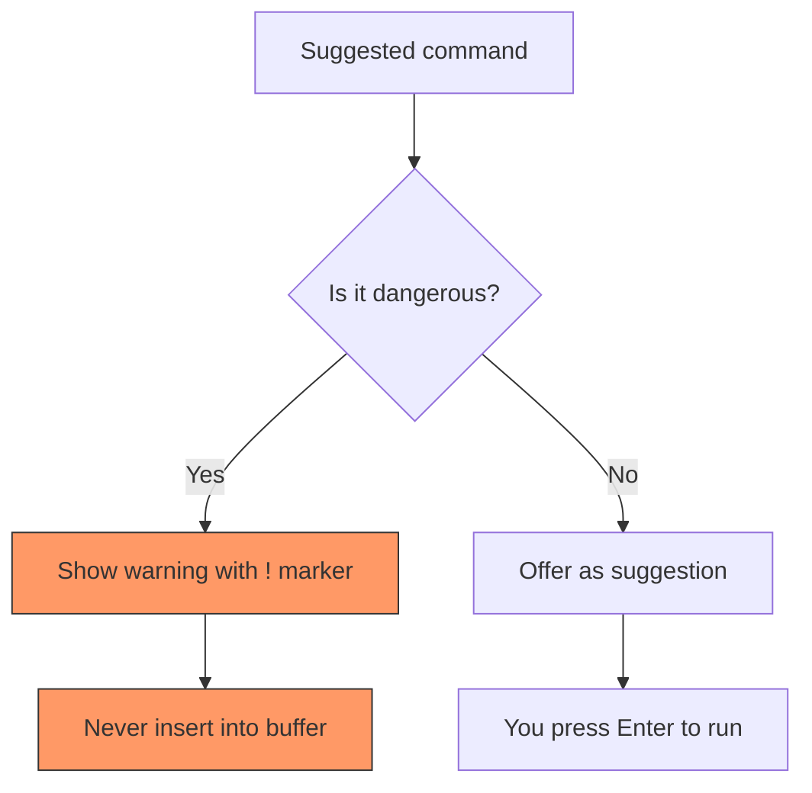
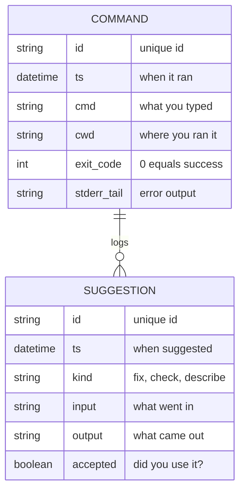
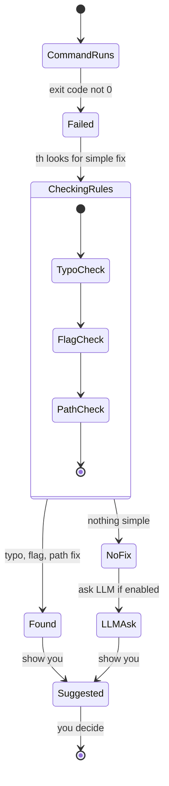
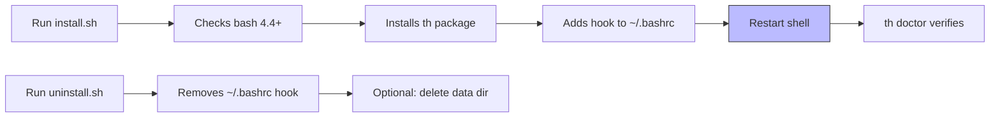

# Architecture

`th` watches your terminal and helps when things go wrong. It never runs a command for you. It only suggests what to type next.

## How it fits together

**What each part does:**

- **Shell hook** : watches every command you run and notes whether it succeeded or failed.
- **Rules engine** : checks for simple mistakes first: typos, wrong flags, missing paths. Fast. No network.
- **LLM** : only called if rules cannot help, and only if you enable it. Runs locally via Ollama by default.
- **You** : always in control. `th` never runs anything. You press Enter.

## When a command fails

## Safety: what `th` will and won't do

`th` never blocks Enter. You always decide what runs.

## What `th` remembers

Everything stays on your computer in a SQLite database. Nothing leaves your machine unless you turn on a remote LLM backend.

## The fix flow

## Install and remove

## What you need

- **bash 4.4 or newer** for the hotkeys. Older bash still runs `th log`, `th help`, `th check`, `th doctor`.
- **Ollama** optional, only if you want LLM-powered fixes. Default model: `qwen3:4b`.
